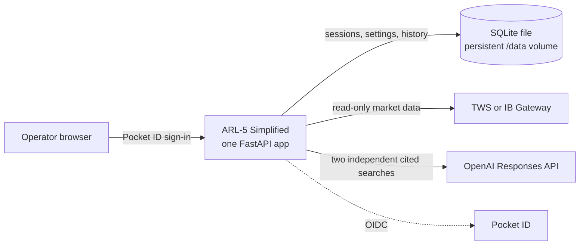

# ARL-5 Simplified

ARL-5 Simplified is a single-user, read-only website that calculates how many MES contracts match a deterministic SPY leverage target. It also monitors narrowly defined pandemic and major-war evidence.

It cannot read an IBKR account or place, modify, approve, or cancel orders. Every result is notional sizing only; margin is not checked.

The dashboard includes one switchable historical chart over the latest 252 completed sessions. It can show a normalized SPY-return rule replay against SPY, close-to-close drawdowns, invested versus zero-exposure periods, SPY versus SMA200, or RV20 and DD20 with their decision thresholds. The replay is a revised-data signal proxy rather than MES execution performance: it assumes fractional exposure at exact session open and close prices and excludes dividends, cash yield, futures basis and rolls, financing, fees, slippage, taxes, margin, and liquidation effects. The chart is derived from persisted IBKR bars and strategy calculations and uses no browser-side charting service.

## What gets deployed

There is one Coolify application and one persistent SQLite volume. There is no PostgreSQL project, worker project, or separate scheduler service.



After deployment, configure these values inside the website:

- strategy amount in USD;
- optional current MES quantity for comparison only;
- reachable TWS or IB Gateway host, port, and client ID;
- OpenAI API key and detector/verifier models.

The OpenAI key is encrypted in SQLite. IBKR credentials are not stored because the app connects to an already-running TWS or Gateway API socket.

## Authentication Setup

Create one confidential Pocket ID OIDC client and assign only the intended operator in Pocket ID.

- Public Client: **Off**
- Callback URL: `https://arl5-simplified.kaufmann.dev/auth/oidc/callback`
- Logout callback URL: `https://arl5-simplified.kaufmann.dev/auth/oidc/logout/callback`
- Flow: Authorization Code with PKCE S256
- Token endpoint authentication: `client_secret_post`

Required authentication environment variables:

- `APP_ORIGIN` — public origin, without a trailing slash.
- `OIDC_ISSUER_URL` — Pocket ID issuer URL, without a trailing slash.
- `OIDC_CLIENT_ID` — confidential client ID.
- `OIDC_CLIENT_SECRET` — confidential client secret.
- `SESSION_SECRET` — random value of at least 32 characters, used for form protection.
- `SETTINGS_ENCRYPTION_KEY` — URL-safe base64 encoding of exactly 32 random bytes; protects the OpenAI key and OIDC logout hint.
- `DATABASE_PATH` — SQLite path; production uses `/data/arl5-simplified.sqlite3`.

Optional authentication variables:

- `SESSION_COOKIE_NAME` — defaults to `arl5_session`.

Generate each random secret separately:

```bash
python -c 'import secrets; print(secrets.token_urlsafe(32))'
```

The app stores only an opaque local session cookie. Sessions have a 24-hour sliding idle timeout and a seven-day absolute limit. Access and refresh tokens are never stored.

## Coolify Deployment

- Build Pack: **Nixpacks**
- Base Directory: `/`
- Domain: `https://arl5-simplified.kaufmann.dev`
- Health check path: `/api/health`
- Instances: exactly **1** (the scheduler runs inside the app)
- Persistent storage: mount a volume at `/data`
- Required variables: all variables from **Authentication Setup** above
- Optional variable: `LOG_LEVEL` defaults to `INFO`

No pre-deployment command, post-deployment command, PostgreSQL database, or companion service is required. SQLite schema migrations run safely when the app starts.

## Interactive Brokers

The website uses only the official `ibapi` package and only these requests:

- SPY contract details and completed regular-session daily bars;
- active quarterly MES contract details;
- live MES bid, ask, last, timestamp, and market-data type.

In TWS or IB Gateway:

1. enable the socket API;
2. enable **Read-Only API**;
3. allow the Coolify host to reach the API socket through a private network or tunnel;
4. use an unused client ID;
5. ensure the account has live CME/MES market data and the SPY historical-data entitlement needed by IBKR.

The website refuses a new result when the connection, contract, completed SPY history, or live MES quote is unavailable. Delayed or frozen MES data is not accepted.

## Local development

```bash
cp .env.example .env
uv sync --all-groups
uv run arl5-simplified
```

Plain HTTP is accepted only when `APP_ORIGIN` uses `localhost` or `127.0.0.1`. Keep the SQLite file outside the repository or use the default ignored local filename.

Checks:

```bash
uv run ruff check app tests
uv run mypy app tests
uv run pytest
```

## API

All endpoints except health and OIDC entry/callback routes require the local session.

- `GET /api/current`
- `PUT /api/settings`
- `GET /api/history`
- `GET /api/events`
- `POST /api/events/check`
- `GET /api/health`

There are deliberately no order, execution, account, position, margin, backtest, optimization, performance, or notification endpoints.
